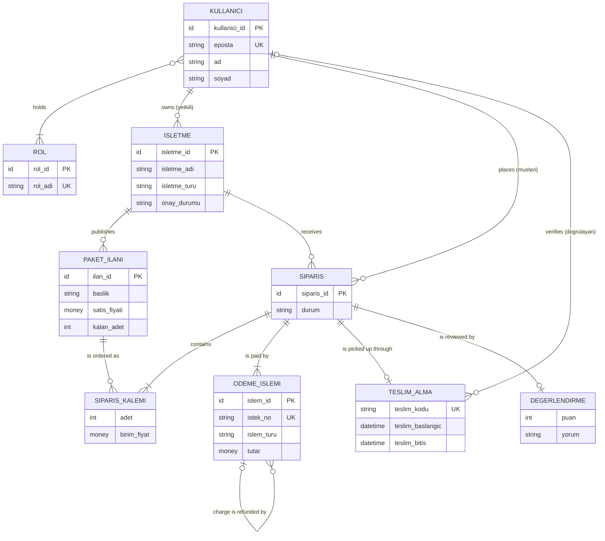

# Conceptual ER diagram

The conceptual model of the platform. Rendered image: [er-diagram.png](er-diagram.png).

## Relationships

| Relationship | Cardinality and participation |
| --- | --- |
| KULLANICI holds ROL | M:N through KULLANICI_ROL. Every user holds at least one role (MUSTERI on registration); a role is held by any number of users. |
| KULLANICI owns ISLETME | 1:N. A business has exactly one owner (yetkili_id); a user owns zero or more businesses, one per branch. |
| ISLETME publishes PAKET_ILANI | 1:N. A listing belongs to exactly one business; a business has zero or more listings. |
| KULLANICI places SIPARIS | 1:N. An order has exactly one customer (musteri_id); a user places zero or more orders. |
| ISLETME receives SIPARIS | 1:N. An order is placed with exactly one business; a business receives zero or more orders. |
| SIPARIS contains PAKET_ILANI | M:N through the associative entity SIPARIS_KALEMI (adet, birim_fiyat). An order contains at least one listing, all of its own business; a listing appears in zero or more orders. |
| SIPARIS is paid by ODEME_ISLEMI | 1:N. A transaction belongs to exactly one order; an order has at least one transaction, of which exactly one is a successful charge. |
| ODEME_ISLEMI (charge) is refunded by ODEME_ISLEMI (refund) | Recursive 1:N through kaynak_islem_id. A refund refers to exactly one charge; a charge has zero or more refunds; a charge refers to none. |
| SIPARIS is picked up through TESLIM_ALMA | 1:0..1. A pickup record belongs to exactly one order (siparis_id is its primary key); an order has at most one. |
| KULLANICI verifies TESLIM_ALMA | 0..1:N. A pickup is verified by at most one user, the owner of the order's business; a user verifies zero or more pickups. |
| SIPARIS is reviewed by DEGERLENDIRME | 1:0..1. A review belongs to exactly one delivered order (siparis_id is its primary key); an order has at most one. |

Only identifying and characteristic attributes are shown; the full column list is in
[relational-schema.md](relational-schema.md).
