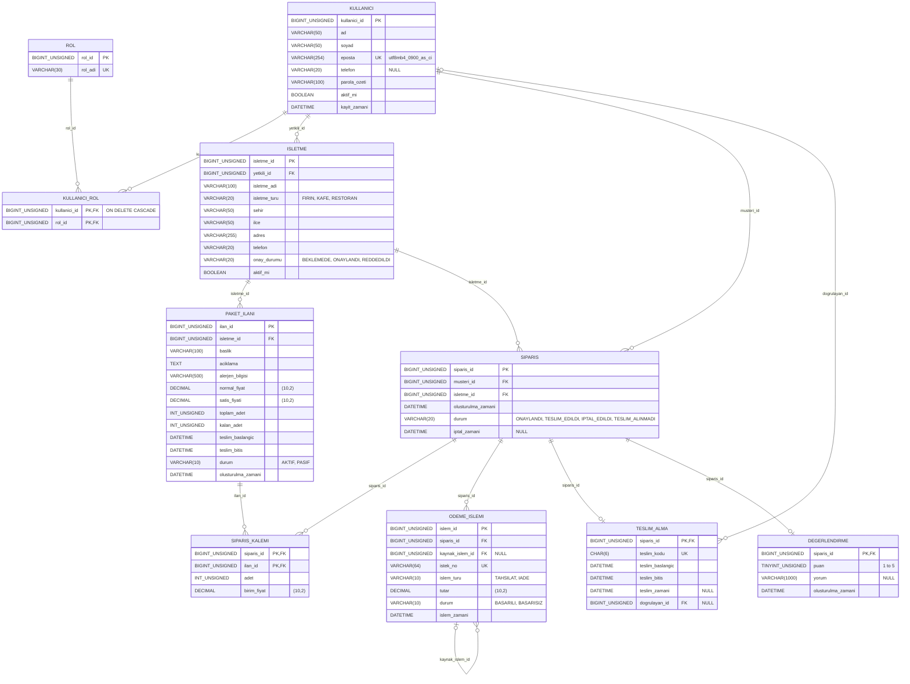

# Relational schema

All tables of `V1__create_schema.sql` with their column types and keys. Rendered image:
[relational-schema.png](relational-schema.png).

Markers: PK primary key, FK foreign key, UK unique key. Money columns are `DECIMAL(10,2)`; Mermaid does not allow the
comma in a type, so the precision is given as a comment. Boolean columns are `BOOLEAN` (`TINYINT(1)` in MySQL).

Unless marked NULL, every column is NOT NULL. All foreign keys use ON DELETE RESTRICT ON UPDATE RESTRICT, except
`KULLANICI_ROL.kullanici_id`, which cascades deletes. The check constraints are listed in
[../constraint-tests.md](../constraint-tests.md).
